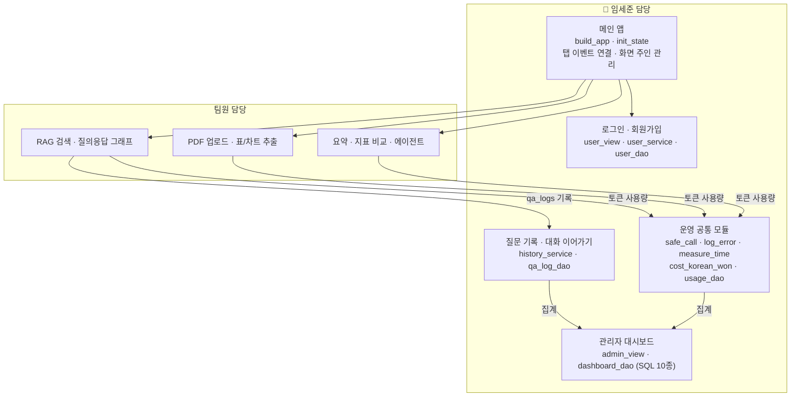
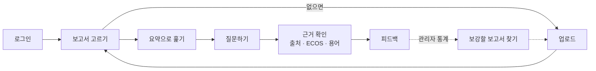
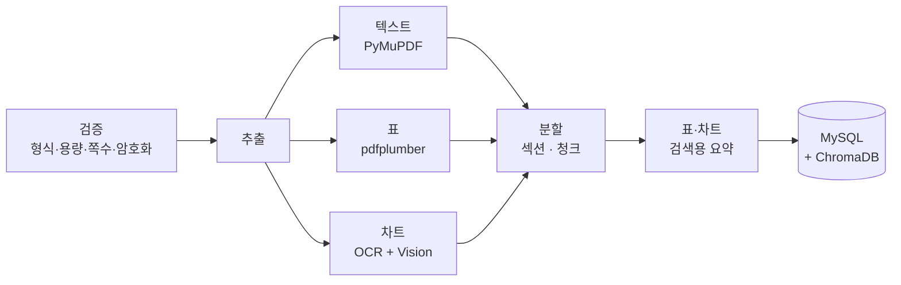
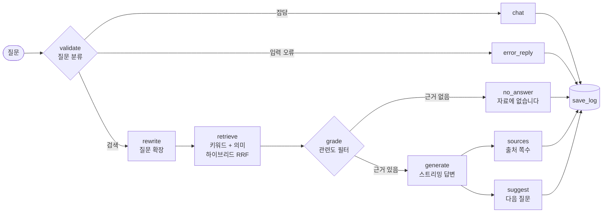
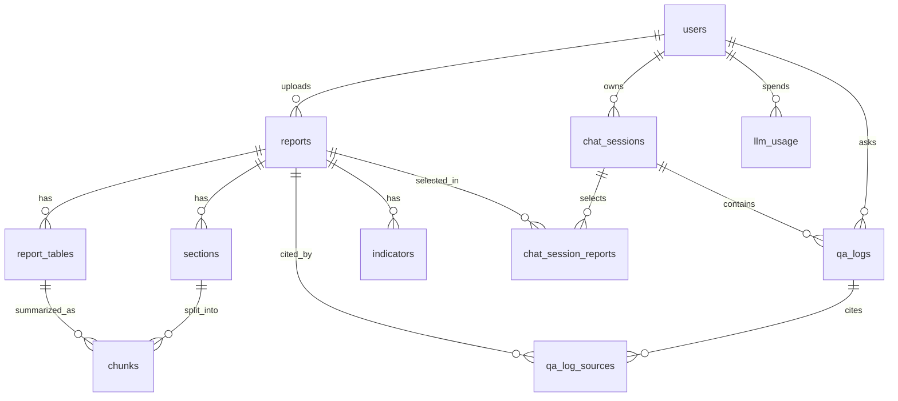
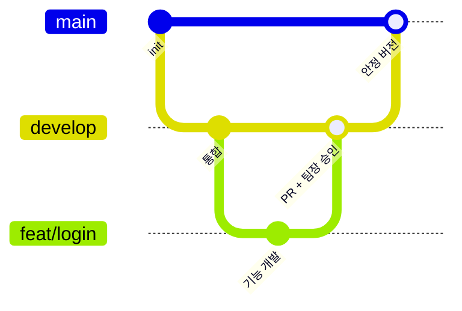

<div align="center">


# HRI Insight Bridge

**경제 보고서 AI 요약·질의응답 및 관리자 모니터링 서비스**

경제 분석 보고서(PDF)를 올리면 **근거 쪽수와 함께 요약·답변**하고,<br/>
여러 보고서의 경제 지표를 **한 표로 비교**해 주는 RAG 기반 웹 서비스입니다.

<br/>


현대 AI 서비스 개발자 과정 · 1차 프로젝트 **4조 Insight Bridge**<br/>
2026.10.21 ~ 2026.11.02

[시연](#시연) · [주요 기능](#주요-기능) · [아키텍처](#시스템-아키텍처) · [임세준 기여](#임세준의-기여-화면관리자운영-계층) · [시작하기](#시작하기) · [팀 소개](#팀-소개)

</div>

> **이 README는 팀원 임세준([@SOLUNA2](https://github.com/SOLUNA2))의 기여를 중심으로 정리한 버전입니다.**<br/>
> 서비스 전체 설명은 그대로 두고, 임세준이 설계·구현한 **메인 앱 · 로그인 · 대화 기록 · 관리자 대시보드 · 예외 처리 · 비용 측정** 영역을 [별도 섹션](#임세준의-기여-화면관리자운영-계층)과 `👤 임세준` 표시로 강조했습니다.


---

## 목차

1. [한눈에 보기](#한눈에-보기)
2. [**임세준의 기여**](#임세준의-기여-화면관리자운영-계층) ⭐
3. [프로젝트 개요](#프로젝트-개요)
4. [시연](#시연)
5. [주요 기능](#주요-기능)
6. [시스템 아키텍처](#시스템-아키텍처)
7. [기술 스택](#기술-스택)
8. [DB 구조](#db-구조)
9. [문제 해결 사례](#문제-해결-사례)
10. [검증 결과](#검증-결과)
11. [시작하기](#시작하기)
12. [폴더 구조](#폴더-구조)
13. [팀 소개](#팀-소개)
14. [프로젝트 진행](#프로젝트-진행)
15. [자체 평가와 회고](#자체-평가와-회고)

---

## 한눈에 보기

<div align="center">

<br/><sub>핵심 기능: 여러 보고서의 경제 지표를 뽑아 차트·표·ECOS 공식 통계로 비교</sub>
</div>

<br/>

서비스 이름 **HRI**는 세 가지 핵심 가치의 머리글자입니다.

| | 가치 | 이렇게 구현했습니다 |
|:-:|---|---|
| **H** | **Highlight** · 필요한 것만 요약 | 3줄 요약, 섹션별 요약(쪽 범위 표시), 여러 보고서 병합 요약 |
| **R** | **Refresh** · 최신 지표 반영 | 한국은행 ECOS 통계로 보고서 수치 검증, 한국수출입은행 환율 조회 |
| **I** | **Integrate** · 여러 보고서를 한눈에 | 본문·표·차트에서 지표를 추출해 보고서 간 비교표와 차트 생성 |

> **근거 우선 원칙**: 모든 답변에 보고서 이름과 쪽수를 붙이고, 근거를 찾지 못하면 LLM을 호출하지 않고 **"자료에 없습니다"** 라고 답합니다.

---

## 임세준의 기여: 화면·관리자·운영 계층

<table>
<tr>
<td width="140" align="center">
<br/>
<b>임세준</b><br/>
<a href="https://github.com/SOLUNA2">@SOLUNA2</a>
</td>
<td>

RAG 파이프라인이 **"답을 만드는 엔진"** 이라면, 임세준은 그 엔진을 **사용자가 쓰고 운영자가 관리할 수 있는 서비스로 감싸는 계층**을 맡았습니다.<br/>
모든 탭을 하나로 묶는 메인 앱, 회원·권한, 대화 기록과 이어가기, 관리자 대시보드, 그리고 모든 화면에 깔린 예외 처리·실행 시간·토큰 비용 측정까지 직접 설계하고 구현했습니다.

</td>
</tr>
</table>

### 숫자로 보는 기여

| 커밋 | 병합된 PR | 코드 변경 | 단독 작성 모듈 |
|:-:|:-:|:-:|:-:|
| **170개** · 팀 내 최다 | **39개** | **+6,276 / −579줄** | **10개 파일** |

<sub>2026.10.23 ~ 11.01, `git log --author` 기준. 단독 작성 모듈은 `git blame` 기준 작성 비율 95% 이상인 파일입니다.</sub>

### 담당 영역 지도



### 핵심 구현

<details open>
<summary><b>① 관리자 대시보드: 설계 → SQL → 화면까지 단독 구현</b> · <code>admin_view.py</code> · <code>dashboard_dao.py</code></summary>
<br/>


- **1차 → 2차로 단계적으로 확장**했습니다. 1차(질문 TOP 10, 자료 유무 응답 비율, 응답 시간·비용, 최근 에러 로그)를 먼저 완성한 뒤, 2차에서 일별 추이 차트, 페르소나 비율, 답변 품질(👍/👎), 근거 없는 질문 목록, 처리 방식(route)별 비율을 더했습니다.
- **집계 SQL 10종**을 직접 작성했습니다. `GROUP BY ... WITH ROLLUP`으로 항목별 수와 합계 행을 한 번에 가져오고, 날짜별 토큰 합계(`llm_usage`)와 평균 응답 시간(`qa_logs`)을 `LEFT JOIN`으로 한 줄에 묶었습니다.
- **원화 비용을 DB에 저장하지 않고 조회 시점에 계산**합니다. 토큰만 모델별로 모아 두고, 대시보드를 열 때 그날 환율로 환산해 단가·환율이 바뀌어도 과거 데이터를 고칠 필요가 없게 했습니다.
- **관리자는 관리자 탭만** 보이도록 역할별 화면을 분리하고, 보고서 관리·통계·에러 로그를 탭으로 나눴습니다. 업로드 목록과 에러 로그에는 페이지 넘김을, 비율 데이터에는 파이 차트를 붙였습니다.

</details>

<details>
<summary><b>② 메인 앱 구조와 사용자 간 화면 분리</b> · <code>app.py</code></summary>
<br/>

- `build_app` · `init_state` · `main`으로 **모든 탭(보고서·요약·질의응답·기록·관리자)을 하나의 Gradio 앱으로 조립**하는 뼈대를 만들고, 각 팀원의 화면 이벤트를 연결했습니다.
- **같은 브라우저에서 다른 사람이 로그인하면 이전 사람의 대화·요약·비교 결과가 남아 보이는 문제**를 발견하고, "지금 화면 내용의 주인(`screen_owner`)"을 추적하는 `clear_other_user_screen`으로 해결했습니다. 같은 사람이 다시 로그인하면 화면을 유지하고, 다른 사람이면 17개 화면 부품을 한 번에 비웁니다.

</details>

<details>
<summary><b>③ 질문 기록과 "대화 이어가기"</b> · <code>history_service.py</code> · <code>qa_log_dao.py</code></summary>
<br/>


- 모든 질문·답변·응답 시간·처리 방식·피드백을 `qa_logs`에 기록하는 `save_qa_log` / `insert_qa_log`를 구현했습니다. 이 기록이 관리자 대시보드의 모든 통계의 재료가 됩니다.
- `restore_session`은 과거 대화를 **화면(gr.Chatbot)과 LangGraph 체크포인터 양쪽에 복원**합니다. 서버가 재시작돼 메모리 기반 체크포인터가 비어 있어도, DB 기록으로 대화 맥락을 다시 채워 **이어서 질문할 수 있게** 했습니다. 이미 맥락이 있으면 건너뛰어 대화가 두 번 쌓이지 않습니다.
- 조회는 항상 `user_id`와 함께 해서 **다른 사람의 대화를 불러올 수 없도록** 막았습니다.

</details>

<details>
<summary><b>④ 회원가입 · 로그인 · 권한</b> · <code>user_view.py</code> · <code>user_service.py</code> · <code>user_dao.py</code></summary>
<br/>


- 회원 스키마, DAO, 서비스, 화면까지 회원 기능 전 계층을 구현했습니다.
- 가입 계정은 항상 일반 사용자로 만들고, 관리자 권한은 DB에서만 부여해 화면으로 권한을 올릴 수 없게 했습니다.
- 로그인 실패 시 "아이디 없음"과 "비밀번호 틀림"을 구분하지 않는 `LoginFailedError` 하나로 알려, 가입된 아이디를 추측할 수 없게 했습니다.

</details>

<details>
<summary><b>⑤ 운영 공통 모듈: 예외 처리 · 실행 시간 · 토큰 비용</b> · <code>logger.py</code> · <code>metrics.py</code> · <code>llm_client.py</code> · <code>usage_dao.py</code></summary>
<br/>

| 모듈 | 하는 일 | 팀 전체 사용 |
|---|---|---|
| `@safe_call` · `log_error` | 화면 이벤트에서 난 오류를 `logs/app.log`에 남기고, 사용자에게는 내부 정보(DB 주소 등)가 없는 안내 문구만 표시. 일반 함수와 **제너레이터(스트리밍) 함수 모두 지원** | 화면 이벤트 **18곳**에 적용 |
| `@measure_time` | 함수 실행 시간을 로그에 기록 | 응답 시간 측정 |
| `cost_korean_won` · `get_usd_krw` | 모델별 토큰 수를 단가표로 달러 환산 → 원화 환산. 환율은 **한국수출입은행 → 한국은행 ECOS → 기본값** 순으로 대체해 외부 API가 죽어도 대시보드가 멈추지 않음 | 대시보드 비용 표 |
| `insert_usage` | 모든 LLM 호출의 기능(flow)·모델·토큰을 `llm_usage`에 기록 | 4개 그래프 전체 |

</details>

### 임세준이 해결한 문제

| 문제 | 원인 | 해결 |
|---|---|---|
| **다른 사용자의 화면이 그대로 보임** | 로그아웃해도 Gradio 화면 부품의 값은 남아 있음 | 화면 주인을 추적해 다른 사람이 로그인하면 17개 부품 초기화 (#321) |
| **"자료 없음 비율"·평균 응답 시간 왜곡** | 잡담·오류 응답까지 함께 집계됨 | `route IN ('rag', 'no_answer')`인 실제 답변만 집계하고, 평균 응답 시간은 답변 하나하나를 같은 무게로 평균 내도록 수정 (#403) |
| **가린 개인정보가 기울임 글씨로 깨짐** | 마스킹 문자 `홍*동`의 `*`를 마크다운이 서식으로 해석 | 화면 표시용 문자열에서만 `*`·`_`를 이스케이프 (#408) |
| **서버 재시작 후 대화 이어가기 불가** | LangGraph 체크포인터가 메모리 기반이라 재시작하면 비어 있음 | DB 기록으로 체크포인터를 다시 채우는 `restore_session` (#253) |
| **새 대화의 첫 질문 기록이 저장되지 않음** | `qa_logs`가 FK로 참조하는 `chat_sessions` 줄이 아직 없어 FK 위반 | 세션 줄을 `ON DUPLICATE KEY UPDATE`로 먼저 만들고 질문 기록과 한 트랜잭션으로 저장 (#304) |

### 검증 방식: DB 없이 돌리는 확인 스크립트 17개

기능마다 `tests/try_*.py` 확인 스크립트를 함께 만들었습니다(로그인, 기록, 대시보드 SQL 1·2차, 화면 주인, 관리자 탭 등 17개). 예를 들어 `try_qa_log_session.py`는 파이썬 기본 **SQLite 메모리 DB에 실제 스키마와 FK를 재현**하고 진짜 `insert_qa_log()`를 실행해, MySQL·`.env` 없이도 FK 위반이 고쳐졌는지 바로 확인할 수 있습니다.

---

## 프로젝트 개요

### 왜 만들었나

경제 보고서를 읽고 활용하는 사람들이 겪는 어려움에서 출발했습니다.

| 문제 | 상황 |
|---|---|
| **분량** | 실제로 사용한 현대경제연구원 보고서 37편은 12~62쪽, 평균 약 25쪽입니다. 한 편을 파악하는 데에도 시간이 오래 걸립니다. |
| **용어 장벽** | 익숙하지 않은 경제 용어에서 읽기가 막힙니다. |
| **비교의 번거로움** | 같은 지표도 기관마다 전망값이 다르고, 보고서마다 흩어진 수치를 직접 표로 만들어야 합니다. |
| **근거 없는 답** | 일반 챗봇은 출처 없이 답하고, 학습 시점의 과거 수치에 머물러 있습니다. |

### 누구를 위한 서비스인가

| 타깃 사용자 | 필요한 것 |
|---|---|
| **기획·전략팀 실무자** | 사업 계획·전략 보고서에 넣을 경제 전망과 근거 수치를 출처까지 빠르게 |
| **신입 애널리스트 · 취준생** | 여러 기관 보고서의 핵심 결론과 수치를 빠르게 파악하고 학습 |
| **일반 직장인** | 3줄 요약과 출처 쪽수로 핵심만 빠르게 확인 |

### 실무자 인터뷰를 반영했습니다

| 인터뷰에서 나온 의견 | 반영한 내용 |
|---|---|
| "여러 보고서에서 필요한 부분만 발췌하는 일이 가장 번거롭다. 하나만 먼저 쓴다면 **여러 보고서 비교**를 쓰고 싶다." | 지표 추출·비교표를 **가장 먼저** 구현한 핵심 기능으로 설정 |
| "제공되는 자료의 출처와 전문성이 고려되는지 의문이다." | 지표·답변마다 출처 보고서와 쪽수를 표시하고, 근거가 없으면 "자료에 없습니다"로 응답 |
| "단순 데이터 나열보다 전망·판단 중심이면 좋겠다." | ECOS 최신 통계를 조회해 보고서 작성 시점의 예측치와 비교 |

### 기존 서비스와 다른 점

| | 차별점 | 설명 |
|:-:|---|---|
| ⭐ | **여러 보고서 지표 추출·비교표** | 본문·표·차트에서 지표를 자동으로 뽑아 이름을 통일하고 보고서 간 비교표·차트로 정리 |
| ① | **근거 우선** | 답변마다 보고서·쪽수 표시, 근거가 없으면 LLM 호출 없이 "자료에 없습니다" |
| ② | **표·차트 복원** | 표는 구조를 보존해 추출하고, 차트 이미지는 OCR과 Vision LLM으로 수치 표로 복원 |
| ③ | **최신 공식 통계 연동** | 에이전트가 ECOS·한국수출입은행 데이터를 조회해 보고서 수치를 검증 |
| ④ | **눈높이 맞춤 설명** | 입문자·실무자·전문가 수준에 맞춰 용어 난이도와 답변 구성을 조절 |

---

## 시연

> 전체 시연 영상(5분 38초): [Hyundai AI 서비스 개발자 과정 1차 프로젝트 4조_Insight Bridge(Highlight Refresh Integrate)](https://youtu.be/TRh1QrnkGGk)
> <!-- TODO: 팀 내부 Drive 링크입니다. 포트폴리오로 공개할 때는 YouTube 등 공개 링크로 교체하세요. -->

아래 GIF는 시연 영상을 기능별로 나눈 것입니다. 각 항목을 눌러 펼쳐 보세요.

<details open>
<summary><b>① 회원가입 · 로그인</b> · <code>👤 임세준</code></summary>
<br/>


- 아이디·비밀번호·이름 세 칸만으로 가입하고, 같은 화면에서 바로 로그인합니다.
- 가입한 계정은 항상 일반 사용자 권한입니다. 로그인하면 역할에 따라 첫 화면이 달라집니다(일반 사용자는 보고서 목록, 관리자는 대시보드).

</details>

<details>
<summary><b>② 보고서 목록 · 검색</b></summary>
<br/>


- 로그인 후 첫 화면은 보고서 라이브러리입니다. 제목·발행기관·발행일·청크 수를 표로 보여 줍니다.
- 검색칸 하나로 제목과 발행기관을 함께 찾고, 고른 보고서를 들고 **요약 보기** 또는 **질의응답으로 이동**합니다.

</details>

<details>
<summary><b>③ PDF 업로드</b></summary>
<br/>


- PDF를 끌어다 놓거나 눌러서 올립니다. 여러 개를 한 번에 올릴 수 있습니다.
- 업로드하면 형식·용량·쪽수·암호화를 검증한 뒤 본문·표·차트를 병렬로 추출해 MySQL과 벡터 DB에 저장합니다.

</details>

<details>
<summary><b>④ 요약 · 분석 (3줄 요약 / 섹션별 요약 / 병합)</b></summary>
<br/>


- **3줄 요약**: 핵심 주장 → 근거 수치 → 시사점 순서의 세 문장입니다.
- **섹션별 요약**: 장 단위로 요약하고 장 제목 옆에 쪽 범위를 붙입니다. 쪽 번호는 AI가 아닌 시스템이 원문 위치에서 가져옵니다.
- **병합하기**: 보고서 2~5개를 대상 보고서 → 공통 의견 → 차이점 → 종합 결론 순서로 정리하고 문장마다 근거 보고서를 표시합니다.

</details>

<details>
<summary><b>⑤ 질의응답 · 출처 · "자료에 없습니다"</b></summary>
<br/>


- 근거로 쓸 보고서와 질문 수준(입문자·실무자·전문가)을 고르고 자연어로 질문합니다.
- 답변은 스트리밍으로 나오고, 끝에 근거 보고서와 쪽수가 붙습니다. 👍/👎 피드백은 관리자 통계로 이어집니다.
- 보고서에 없는 내용을 물으면 지어내지 않고 **"자료에 없습니다"** 라고 답합니다.

</details>

<details>
<summary><b>⑥ 용어 검색</b></summary>
<br/>


- 질의응답 화면 오른쪽 사이드바에서 대화를 떠나지 않고 용어를 찾습니다.
- 쉬운 풀이와 ECOS 통계용어 사전의 원문 정의를 함께 보여 줍니다.

</details>

<details>
<summary><b>⑦ 과거 대화 이어가기</b> · <code>👤 임세준</code></summary>
<br/>


- 대화마다 마지막 시각·첫 질문·질문 수를 보고 골라서 **대화 이어가기**를 누르면 이전 대화가 그대로 복원됩니다.
- 기록은 계정별로 분리되고, 개인정보는 가려진 채로 표시됩니다.

</details>

<details>
<summary><b>⑧ 수치 검증 (ECOS)</b></summary>
<br/>


- 고른 보고서의 수치를 한국은행 ECOS 공식 통계와 자동으로 대조합니다.
- 결과를 일치·근사 / 차이 / ECOS로 보완한 항목으로 나누고, 비교하지 못한 항목도 이유와 함께 알려 줍니다.

</details>

<details>
<summary><b>⑨ 지표 비교표 · 차트 ⭐ 핵심 기능</b></summary>
<br/>


- 보고서 2~5개를 골라 지표를 추출하면 **비교 차트 → 비교 표 → ECOS 데이터** 순으로 깊이를 조절해 볼 수 있습니다.
- 두 개 이상의 보고서에 함께 나온 지표만 그리고, 단위가 다른 지표는 차트를 나눠 그립니다.
- 비교 표의 값마다 출처 쪽수를 붙이고, 마지막 열에 보고서 간 차이(최대-최소)를 보여 줍니다.

</details>

<details>
<summary><b>⑩ 관리자 대시보드</b> · <code>👤 임세준</code></summary>
<br/>


- **보고서 관리**: 보고서 업로드와 전체 목록을 확인합니다.
- **통계**: 일별 질문 수와 응답 시간, 질문 TOP 10, 페르소나·처리 방식별 비율, 답변 품질(피드백, "자료에 없습니다" 비율), 기능별 토큰 사용량과 원화 비용을 봅니다.
- **시스템 에러 로그**: 오류가 자동으로 기록되며 최근 순으로 확인합니다.

</details>

---

## 주요 기능

### 설계 원칙

화면을 만들 때 아래 네 가지를 판단 기준으로 삼았습니다.

| | 원칙 | 내용 | 적용된 곳 |
|:-:|---|---|---|
| 01 | **근거가 보이는 AI** | 답변·요약·비교표에 보고서 이름과 쪽수를 붙이고, 근거가 없으면 지어내지 않습니다. | 질의응답 출처, 섹션 요약 쪽 범위, 비교표 쪽수, 수치 검증 |
| 02 | **보고서에서 시작하는 흐름** | 모든 기능은 "어떤 보고서를 볼지" 고르는 데서 시작하고, 선택 방식(최대 5개 체크박스)은 어느 화면에서나 같습니다. | 요약 보기 · 질의응답으로 이동 버튼, 공통 보고서 선택 |
| 03 | **사용자 눈높이에 맞춘 설명** | 입문자·실무자·전문가에 맞춰 용어 난이도와 답변 구성을 바꿉니다. | 질문 수준, 용어 검색 |
| 04 | **흐름을 끊지 않는 도구** | 수치 검증·용어 검색·대화 기록은 채팅 안이나 옆에서 열리고, 오래 걸리는 작업은 경과 시간과 단계를 보여 줍니다. | 수치 검증 메시지, 용어 사이드바, 진행 표시 |

### 화면 구성

| 메뉴 | 화면 | 주요 기능 | 권한 |
|---|---|---|---|
| 로그인 | 로그인·회원가입 `👤 임세준` | 가입, 로그인, 역할별 첫 화면 분기 | 전체 |
| 보고서 | 목록·검색 | 보고서 검색, 요약·질의응답으로 바로 이동 | 사용자 |
| 보고서 | 지표 비교표 | 보고서 2~5개의 경제 지표를 차트·표·ECOS 데이터로 비교 | 사용자 |
| 보고서 | 업로드 | 보고서 PDF 업로드(다중 업로드, 중복 업로드 방지) | 사용자 |
| 요약, 분석 | 요약·분석 | 3줄 요약, 섹션별 요약, 여러 보고서 병합 | 사용자 |
| 질의응답 | 채팅 | 보고서 근거 질의응답, 질문 수준, 추천 질문, 출처, 피드백 | 사용자 |
| 질의응답 | 수치 검증 · 용어 검색 · 과거 대화 | ECOS 대조, 용어 사이드바, 대화 이어가기 (과거 대화: `👤 임세준`) | 사용자 |
| 관리자 | 보고서 관리 · 통계 · 에러 로그 `👤 임세준` | 업로드, 사용 현황·답변 품질·비용, 오류 기록 | 관리자 |

### 사용자 흐름



관리자는 통계에서 "자료에 없습니다" 비율과 근거를 찾지 못한 질문을 보고 부족한 보고서를 올린 뒤, 비율이 줄었는지 다시 확인하는 순환 구조로 운영합니다.

---

## 시스템 아키텍처


### 4계층 구조

| 계층 | 역할 | 구성 |
|---|---|---|
| ① 화면 | 사용자가 보는 웹 화면 | Gradio (`hri/view`), 메인 앱 조립·로그인·기록·관리자 화면은 `👤 임세준` |
| ② 기능 처리 | 요청을 받아 업무 흐름 실행 | Service (`hri/service`) + LangGraph 그래프 4종 (`hri/graph`) |
| ③ AI · 외부 데이터 | 답변 생성과 최신 정보 | OpenAI (LLM·Vision·임베딩), ECOS, 한국수출입은행 |
| ④ 저장소 | 정보 보관 | MySQL (보고서·지표·기록·비용), ChromaDB (검색용 벡터 색인) |

### LangGraph 그래프 4종

| 그래프 | 파일 | 역할 |
|---|---|---|
| **ingest** | `hri/graph/ingest_graph.py` | PDF 검증 → 텍스트·표·차트 병렬 추출 → 섹션·청크 분할 → 표·차트 요약 → 저장 |
| **qa** | `hri/graph/qa_graph.py` | 질문 분류 → 질문 확장 → 하이브리드 검색 → 관련도 판단 → 답변 생성 → 출처·기록 |
| **summary** | `hri/graph/summary_graph.py` | 3줄 요약, 섹션별 요약, 여러 보고서 병합 |
| **agent** | `hri/graph/agent_graph.py` | Tool Calling 에이전트: 요약·검증·병합·ECOS 조회 도구를 골라 실행(반복 횟수 제한) |

### RAG 파이프라인

**업로드 흐름**



**질의 흐름** (`qa_graph`)



**설계 포인트**

- **근거 없음 규칙**: 의미 검색 결과가 0건이면 키워드 결과가 있어도 빈 결과로 처리하고, LLM 호출 없이 "자료에 없습니다"로 답합니다.
- **검색용과 답변용 분리**: 표·차트는 요약문으로 검색하고, 답변에는 원본 표를 사용합니다.
- **큰 단락 · 작은 조각**: 작은 청크로 찾고, 답변 근거로는 그 청크가 속한 섹션 원문을 사용합니다.

### 프롬프트 설계

| 갈래 | 기법 | 내용 |
|---|---|---|
| 답변 수준 맞춤 | System 역할 + Few-shot | 입문자·실무자·전문가별 모범 답안으로 말투와 난이도를 맞춤 |
| 정해진 형식 | CoT + 구조화 출력(Pydantic) | 3줄 요약(주장 → 근거 → 시사점), 지표 추출 결과를 바로 DB에 저장 |
| 근거 기반 답변 | 구분자(`###`) + 규칙 | `[자료]`만 근거로 답하고 없으면 "자료에 없습니다" |
| 도구 사용 에이전트 | Tool Calling | ECOS 통계·환율 조회 도구를 AI가 골라 호출하고 결과를 보고 다시 판단 |

모든 LLM 호출의 토큰 사용량을 `llm_usage` 테이블에 기록해 관리자 대시보드에서 기능별 원화 비용으로 보여 줍니다. (사용량 기록·원화 환산·대시보드: `👤 임세준`)

> 자세한 내용: [`docs/project_structure.md`](docs/project_structure.md) · [`docs/prompt_design.md`](docs/prompt_design.md) · [`docs/qa_design.md`](docs/qa_design.md)

---

## 기술 스택

| 분류 | 기술 |
|---|---|
| **Language** | Python 3.11 |
| **LLM · Framework** | OpenAI API (`gpt-6-luna`, `text-embedding-3-large`), LangChain 1.4, LangGraph 1.2, Pydantic v2 |
| **Vector DB · RDB** | ChromaDB 1.5, MySQL 8.0 (11개 테이블, PyMySQL) |
| **문서 처리** | PyMuPDF (텍스트·차트 이미지), pdfplumber (표), EasyOCR (차트 수치 대조), pypdf |
| **외부 API** | 한국은행 ECOS (경제통계·통계용어), 한국수출입은행 (환율) |
| **UI · 시각화** | Gradio 6.30, Matplotlib |
| **테스트** | pytest |
| **협업** | Git · GitHub (Issue · PR · CODEOWNERS), Poetry |

---

## DB 구조



| 영역 | 테이블 | 설명 |
|---|---|---|
| 보고서 내용 | `reports`, `sections`, `chunks`, `report_tables`, `indicators` | 보고서를 섹션(큰 단락)과 청크(작은 조각)로 나눠 저장. 지표는 값·단위·기간·쪽수와 함께 별도 저장해 비교표의 재료로 사용 |
| 대화·기록 | `chat_sessions`, `chat_session_reports`, `qa_logs`, `qa_log_sources` | 질문·답변은 개인정보를 가려 기록하고, 답변에 실제로 쓴 출처를 함께 저장 |
| 회원·사용량 | `users`, `llm_usage` | 회원과 역할, 호출별 토큰 사용량과 비용 (회원·사용량·기록 DAO와 대시보드 집계 SQL: `👤 임세준`) |

> 스키마 전체: [`sql/schema.sql`](sql/schema.sql)

---

## 문제 해결 사례

<details open>
<summary><b>1. 차트 검출 오탐: 337개 → 4개</b></summary>

- **문제**: 벡터 그래픽 영역을 차트로 검출했더니 337개 중 실제 차트는 0개였습니다. 표, 글상자, 테두리가 차트로 잡혔습니다.
- **해결**: 실제 보고서 데이터를 분석해 제외 규칙 4개를 정했습니다.
- **결과**: 오탐 337개가 4개로 줄었고, 진짜 벡터 차트 11개는 모두 유지했습니다.

</details>

<details>
<summary><b>2. 표 검수 실패 처리: 버리지 않고 "저장하되 경고"</b></summary>

- **문제**: 구조 검수에서 걸린 표를 버리면 294개 중 137개(약 47%)가 검색에서 빠졌습니다.
- **해결**: 검수에 실패한 표도 저장하되 경고를 남기는 방식으로 정했습니다. 신뢰도가 낮은 값은 "검토 필요"로 표시해 사용자가 원문을 확인하게 했습니다.

</details>

<details>
<summary><b>3. "자료에 없습니다" 규칙이 동작하지 않던 문제</b></summary>

- **문제**: 흔한 단어가 키워드(LIKE) 검색에 걸려 보고서 밖 질문에도 검색 결과가 생겼고, 근거 없음 응답이 나오지 않았습니다.
- **해결**: 의미 검색이 0건이면 키워드 결과가 있어도 빈 결과로 처리하도록 바꿨습니다.

</details>

<details>
<summary><b>4. 대시보드 수치 왜곡</b> · <code>👤 임세준</code></summary>

- **문제**: 잡담과 오류 응답이 섞여 "자료 없음 비율"이 부풀려졌습니다.
- **해결**: 처리 방식(route)이 `rag`·`no_answer`인 응답만 집계하도록 바꿔 실제 답변 품질을 보여 주게 했습니다.
- 임세준이 해결한 다른 사례는 [여기](#임세준이-해결한-문제)에 정리했습니다.

</details>

---

## 검증 결과

**확인된 결과**

- **실데이터 점검**: 현대경제연구원 보고서 37편에서 표 294개, 차트 875개(캡션 868개)를 검출했습니다.
- **변조 테스트**: 코드를 일부러 망가뜨려 테스트가 잡아내는지 확인했습니다. 차트 21·13·27가지, 표 15가지, 그래프 8가지 변조를 모두 감지했습니다.

**측정 결과** 

| 항목 | 결과 |
|---|---|
| 정답 질문 정확도 | `93.2%` |
| 출처 페이지 일치 | `100%` |
| 보고서 밖 질문 → "자료에 없습니다" | `100%` |
| 평균 응답 시간 | `7.0 초` |

---

## 시작하기

### 1. 준비물

| 항목 | 버전 · 비고 |
|---|---|
| Python | **3.11** (3.12 이상 불가) |
| MySQL | 8.0 이상 |
| OpenAI API 키 | 필수 |
| ECOS API 키 | 지표·환율 패널, 수치 검증용 (한국은행 ECOS) |
| 한국수출입은행 API 키 | 토큰 비용 원화 환산용 (없으면 해당 기능만 제한) |

### 2. 설치

```bash
git clone https://github.com/hyundai-insight-bridge/highlight-refresh-integrate.git
cd highlight-refresh-integrate

python -m venv .venv
# Windows
.venv\Scripts\activate
# macOS / Linux
source .venv/bin/activate

pip install -r requirements.txt
```

설치에는 PyTorch(EasyOCR 의존성)가 포함되어 수 분이 걸립니다. Linux에서는 CUDA 패키지까지 받아 수 GB가 필요할 수 있습니다.
Poetry를 쓰는 경우 `poetry env use 3.11` → `poetry install`로도 같은 환경을 만들 수 있습니다.

### 3. DB 준비 (MySQL)

```sql
CREATE DATABASE hyb_db DEFAULT CHARACTER SET utf8mb4 COLLATE utf8mb4_0900_ai_ci;
```

```bash
mysql -u root -p hyb_db < sql/schema.sql
```

`schema.sql`은 여러 번 실행해도 안전합니다(없는 테이블만 생성).

### 4. 환경 변수

```bash
# Windows (PowerShell)
Copy-Item .env.example .env
# macOS / Linux
cp .env.example .env
```

`.env`에서 최소한 아래 값을 채웁니다. 나머지는 기본값 그대로 두면 됩니다.

| 키 | 설명 |
|---|---|
| `OPENAI_API_KEY` | OpenAI API 키 |
| `ECOS_API_KEY`, `KOREAEXIM_API_KEY` | 외부 지표·환율 API 키 |
| `MYSQL_USER`, `MYSQL_PASSWORD` | 로컬 MySQL 계정 |
| `CHROMA_MODE` | `persistent` 유지 (로컬 폴더 사용) |

### 5. 실행

```bash
python app.py
```

브라우저에서 `http://localhost:7860`에 접속해 **회원가입** 후 로그인합니다.

- 처음 실행하면 Chroma가 비어 있으므로 **보고서(PDF)를 먼저 업로드**해야 요약·질의응답을 사용할 수 있습니다.
- 첫 PDF 처리 시 EasyOCR이 OCR 모델을 내려받기 때문에 인터넷 연결과 약간의 시간이 필요합니다.
- 관리자 화면을 쓰려면 가입한 계정의 역할을 바꿉니다.

  ```sql
  UPDATE users SET role = 'admin' WHERE user_id = '<아이디>';
  ```

---

## 폴더 구조

```text
highlight-refresh-integrate/
├─ app.py                 실행 파일 (hri.view.app.main 호출)
├─ hri/                   애플리케이션 패키지
│  ├─ view/               Gradio 화면 (보고서·요약·질의응답·기록·관리자)  👤 app·user·history·admin
│  ├─ service/            화면 요청 처리 흐름
│  ├─ graph/              LangGraph 그래프 (ingest · qa · summary · agent)
│  ├─ loader/             PDF 텍스트·표·차트 추출
│  ├─ splitter/           섹션·청크 분할
│  ├─ vector_store/       임베딩, Chroma 저장
│  ├─ retriever/          키워드·의미·하이브리드 검색
│  ├─ prompt/             RAG·요약·페르소나 프롬프트
│  ├─ memory/             대화 기록 관리
│  ├─ router/             Tool Calling 도구 목록·에이전트 실행
│  ├─ llm/                LLM 호출·비용 계산  👤 원화 비용·환율
│  ├─ api/                ECOS·환율 외부 API
│  ├─ dao/                MySQL 접근  👤 user·qa_log·usage·dashboard
│  ├─ domain/schemas/     Pydantic 모델
│  ├─ config/ exception/ util/ source/ suggest/  👤 settings·errors·logger·metrics
├─ sql/schema.sql         MySQL 스키마
├─ docs/                  설계 문서, 시연 GIF (docs/demo)
└─ assets/                폰트·로고
```

자세한 구조는 [`docs/project_structure.md`](docs/project_structure.md)를 참고하세요.

---

## 팀 소개

<div align="center">

|  |  |  |  |  |  |
|:-:|:-:|:-:|:-:|:-:|:-:|
| **류현수** | **김희진** | **서동안** | **엄정현** | **임세준** ⭐ | **장유빈** |
| 팀장 | 팀원 | 팀원 | 팀원 | 팀원 | 팀원 |
| 환경 · 협업 · 통합 · ECOS | 요약 · 업로드 · 에이전트 | 질의응답 · 프롬프트 | 문서 처리 · Langgraph | **화면 · 회원 · 기록 · 관리자** | RAG 검색 · 지표 비교 |
| [@HyeonsuRyu](https://github.com/HyeonsuRyu) | [@gmlwls02190](https://github.com/gmlwls02190) | [@dongan0718](https://github.com/dongan0718) | [@string2015](https://github.com/string2015) | [@SOLUNA2](https://github.com/SOLUNA2) | [@HappYuBeen](https://github.com/HappYuBeen) |

</div>

<!-- TODO: GitHub 프로필 사진이 아닌 다른 사진을 쓰려면 위 img 경로를 바꾸세요. 각 팀원의 아이디가 맞는지도 확인해 주세요. -->

각 이름을 눌러 담당 업무와 회고를 확인하세요.

<details>
<summary><b>류현수</b> · 팀장 · 개발 환경, 협업 규칙, UI 통합</summary>
<br/>

| 항목 | 내용 |
|---|---|
| GitHub | [@HyeonsuRyu](https://github.com/HyeonsuRyu) |
| 연락처 | hsoo112149@gmail.com |
| 담당 업무 | Git·가상환경·DB 환경 세팅, 폴더 구조, 환율 API·용어 풀이, 추천 질문, 테스트 시나리오·실행 재현 테스트 |

**주요 기여**

- 협업 규칙(`CONTRIBUTING.md`, 이슈·PR 템플릿, CODEOWNERS) 수립과 PR 리뷰·승인
- Poetry 기반 개발 환경 구성, `requirements.txt` 내보내기, 설치 가이드 정리
- 챗봇 성능 개선
- 색 테마 통일, 탭 이동 문제 해결, 대화 이어가기를 질의응답 탭에 통합하는 등 UI 개선

**회고**

> `[프로젝트에서 맡은 역할과 가장 기억에 남는 순간]`  
> 팀장을 맡아 프로젝트 작업 분담과 일정 관리를 담당하고, 외부 데이터 API 연결과 챗봇 정확도 향상, 코드 통합을 담당하였습니다. 짧은 일정 동안 해야하는 작업이 많아 팀원들에게 작업을 무리하게 나누었습니다. 그럼에도 불만 없이 맡은 일을 마무리해주어 결과물이 나오는 모습을 보며 팀원들에게 감사함을 느꼈습니다.

> `[잘한 점 · Keep]`  
> 협업 규칙을 잘 정하고 프로젝트를 시작하여 통합을 큰 충돌 없이 할 수 있었습니다. 또한 끊임 없는 소통을 통해 작업이 중복되거나 해야하는 일을 파악하기 어려운 경우가 없었던 것이 잘 된 점이라고 생각합니다.

> `[어려웠던 점과 해결 과정 · Problem]`  
> LLM 모델의 특성을 이해하지 못 해 챗봇의 정확도가 나오지 않았습니다. 성능이 낮은 원인을 하나씩 제거해보며, 모델 자체의 문제일 수 있다는 결론에 도달하였습니다. 이후 teamperature를 0으로 하기 위하여 reasoning 모델인 gpt-6-luna의 effort를 none로 설정한 것이 문제임을 알게 되었고 허용된 모델 중 reasoning이 없는 gpt-4.1로 모델을 변경하며 문제를 해결하였습니다.

> `[다음에 시도할 것 · Try]`  
> 다음 프로젝트에는 각 작업을 수행하며 걸린 시간을 기록하고 이후 프로젝트 진행에 필요한 기간을 예상하는데 필요한 지식을 쌓아보고 싶습니다.

</details>

<details>
<summary><b>김희진</b> · 요약, 업로드, Tool Calling 에이전트</summary>
<br/>

| 항목 | 내용 |
|---|---|
| GitHub | [@gmlwls02190](https://github.com/gmlwls02190) |
| 연락처 | ksh02190@gmail.com |
| 담당 업무 | 키워드 검색, 요약 전체(3줄·섹션), 임베딩·Chroma·보고서 DAO, 업로드 통합·화면, Tool Calling 도구·에이전트 루프 |

**주요 기여**

- 3줄 요약·섹션별 요약 기능과 요약 화면 구현
- 보고서·섹션·청크 DAO 작성
- 단일·다중 업로드 화면 구성, 중복 업로드 제한
- 여러 보고서 병합, 보고서 검증·보완 기능을 질의응답에 연결
- Tool Calling 도구 목록(`TOOLS`) 정의

**회고**

> `[프로젝트에서 맡은 역할과 가장 기억에 남는 순간]`  
> 청킹, 임베딩, 유사도 기능, 다중 보고서 병합, 보고서 검증 보완을 담당했습니다. 검증 보완 기능을 질의 응답 탭에 "수치 검증"버튼에 연결하고 처음 실행했을 때 보고서의 수치가 화면에 나왔지만 대부분 "비교할 ECOS 값이 제공되지 않습니다"로 표시됐습니다. 기능이 오류 없이 돌아가는 것과 검증이 제대로 되는 것은 다르다는 것을 처음 체감했습니다. 원인을 찾아보니 ECOS에 값이 없는 것이 아니라 가장 최근 시점 하나만 조회하는 구조여서 그 후 "동작한다"에서 멈추지 않고 결과가 실제로 맞는지 확인하게 됐습니다.

> `[잘한 점 · Keep]`  
> 요약, 병합, 검증 보완을 함수로만 만들지 않고 화면에서 눌러 결과를 볼 수 있는 상태까지 연결했습니다. 연결 상태를 점검해 빠진 곳을 찾았고, 그 결과로 수치 검증을 질의 응답 탭의 버튼으로 연결했습니다.  
> 병합과 검증에서는 보고서 하나가 실패해도 나머지는 계속 진행하고, 사용자에게는 안내 문구를 보여 줍니다. ECOS 오류, 형식 오류, 일반 오류를 구분해 처리했습니다.  
> VerifyResult, Indicator 같은 스키마와 safe_call 같은 공통 유틸을 그대로 쓰고, 팀원 파일을 건드릴 때는 먼저 공유했습니다.  
> 파일 해시로 사전 검사하고 DB에 file_hash를 저장했습니다.  

> `[어려웠던 점과 해결 과정 · Problem]`  
> 수치 검증이 거의 "검증하지 못한 항목"으로 나왔는데 지표 1개, 시점 1개만 조회하는 구조였습니다. 지표 선택이 실행마다 달라지고 성장률(%)이 금액 통계표와 연결되는 문제도 있었습니다. 원인은 확인했고 조회 기간 확대와 통계표 선택 기준 보강으로 개선하는 방안을 정리했습니다.

> `[다음에 시도할 것 · Try]`  
> 수치 검증을 한 시점이 아니라 지표의 전체 기간을 한 번에 조회하고, 단위(%, 금액, 지수)가 맞는 통계표만 고르도록 개선합니다.

</details>

<details>
<summary><b>서동안</b> · 질의응답 설계, 프롬프트, 개인정보 보호</summary>
<br/>

| 항목 | 내용 |
|---|---|
| GitHub | [@dongan0718](https://github.com/dongan0718) |
| 연락처 | dongan0912@gmail.com |
| 담당 업무 | 질의응답·프롬프트 설계, 입력 검증·개인정보 마스킹, 공통 LLM 모듈, 답변 수준 프롬프트, 테스트 전반, 시연 영상 |

**주요 기여**

- [질의응답 설계서](docs/qa_design.md)와 [프롬프트 설계서](docs/prompt_design.md) 작성
- 입문자·실무자·전문가 페르소나 프롬프트 작성과 테스트
- 질의응답 스키마 정리, 출처 쪽수 검증 추가
- 개인정보 마스킹, 질의응답 입력 오류 예외 정의
- 공통 LLM 호출 함수와 잡담 응대 구현

**회고**

> `[프로젝트에서 맡은 역할과 가장 기억에 남는 순간]`  
> 역할: 질의응답 설계, 프롬프트, 개인정보 보호, 테스트  
> 가장 기억에 남는 순간: 테스트를 진행하면서 챗봇이 설계대로 잘 작동이되고 구현이 되었을 때가 가장 기억에 남는 것 같습니다.  

> `[잘한 점 · Keep]`  
> 페르소나를 입문자, 실무자, 전문가에 따라 답변하도록 명확한 기준을 제시하였다.

> `[어려웠던 점과 해결 과정 · Problem]`  
> 기본 git 활용과 기능 구현할 때 작성된 코드를 이해하는 부분이 가장 어려웠던 것 같습니다. 그때마다 팀장님과 여러 팀원분들이 많이 도와주시고, 설명도 쉽게 해주셔서 잘 진행이 되었던 것 같습니다.

> `[다음에 시도할 것 · Try]`  
> 이번에는 테스트를 주로 맡아서 진행하였는데 다음에는 다양한 기능 부분을 해보고 싶고, 그 전에 전반적인 내용 이해력을 높이기 위해 개인적으로 노력해야 할 것 같습니다.

</details>

<details>
<summary><b>엄정현</b> · PDF 문서 처리, 표·차트 추출, ECOS</summary>
<br/>

| 항목 | 내용 |
|---|---|
| GitHub | [@string2015](https://github.com/string2015) |
| 연락처 | string.ai.class@gmail.com |
| 담당 업무 | 보고서 수집, PDF 검증·추출, 표 추출·변환·요약, ECOS API 전반, 외부 데이터 설계, 발표 리허설·발표 |

**주요 기여**

- 표 추출·변환 기능과 표 구조 검증(빈 셀·열 개수 안전장치)
- 차트 영역 검출과 OCR 함수 구현, 차트 구조 검수
- 업로드 그래프(`ingest_graph`)와 질의응답 그래프(`qa_graph`), 에이전트 그래프 초안 작성
- 질의응답 답변·기록 노드와 출처 처리 구현

**회고**

> `[프로젝트에서 맡은 역할과 가장 기억에 남는 순간]`  
> langGraph 구현  
> 외부데이터 스키마 작성  
> 문서 업로드  

> `[잘한 점 · Keep]`  
> 팀원 간의 업무분배와 소통  
> 주말도 새벽도 가리지 않고 받아주는 슬랙과 pr  

> `[어려웠던 점과 해결 과정 · Problem]`  
> 각자 기능을 개발 하고 합치면서 오류가 생기는 부분을 수정하는게 제일 어려웠던것 같다. 연결된 부분의 담당자 끼리 바로바로 소통하면서 문제가 되는 코드를 수정하면서 진행했다. 각가 생각한 부분과 다른 부분이 있어서 얘기가 길어지는 경우가 있었다.

> `[다음에 시도할 것 · Try]`  
> 배포없이 로컬에서만 진행헀는데 배포까지 진행 할 수 있으면 좋겠다.

</details>

<details open>
<summary><b>임세준</b> ⭐ · 메인 앱, 회원·기록, 관리자 대시보드, 운영 공통 모듈</summary>
<br/>

| 항목 | 내용 |
|---|---|
| GitHub | [@SOLUNA2](https://github.com/SOLUNA2) |
| 연락처 | sejunqw@gmail.com |
| 담당 업무 | 화면 설계, 메인 앱 구조, 로그인·회원, 대화·질문 기록, 관리자 대시보드(SQL·화면), LLM 사용량·원화 비용, 예외 처리·로그, UI 통합·다듬기 |
| 기여 규모 | 커밋 **170개(팀 최다)** · 병합 PR **39개** · **+6,276줄** · 단독 작성 모듈 10개 |

**주요 기여** · 자세한 내용은 [임세준의 기여](#임세준의-기여-화면관리자운영-계층) 섹션 참고

- **관리자 대시보드 단독 구현**: 집계 SQL 10종(`WITH ROLLUP`, `LEFT JOIN`) → 데이터 조립 → 화면·차트까지 1차·2차로 확장
- **메인 앱 뼈대**: `build_app`·`init_state`로 전 탭을 조립하고 팀원 화면 이벤트 연결, 사용자 간 화면 분리(`clear_other_user_screen`)
- **회원·권한**: 회원 스키마·DAO·서비스·화면 전 계층, 관리자 전용 탭 분리
- **질문 기록·대화 이어가기**: `qa_logs` 기록과 LangGraph 체크포인터 복원(서버 재시작 후에도 이어서 질문 가능)
- **운영 공통 모듈**: `@safe_call`(화면 18곳 사용)·`@measure_time`·토큰 원화 비용 계산·환율 3단계 대체
- 로고 적용, 마스킹 표시 개선, 질의응답·보고서·요약 탭 UI 다듬기, UI/UX 설명서 작성

**회고**

> `[프로젝트에서 맡은 역할과 가장 기억에 남는 순간]`  
> 회원가입·로그인, 질문 기록 저장·조회, LLM 사용량 기록, 관리자 대시보드(SQL·화면), 예외 처리, 메인 앱을 담당했습니다.
> 가장 기억에 남는 순간은 대시보드에 실제 질문 기록이 집계되어 TOP 10과 일별 추이 차트가 처음 화면에 떴을 때입니다.
> 쌓아 온 DB 설계와 SQL이 하나로 이어지는 걸 확인할 수 있었습니다.

> `[잘한 점 · Keep]`  
> 대시보드를 한 번에 다 만들지 않고 1차(핵심 지표) → 2차(추이·품질·처리 방식)로 나눠, 매 단계 화면에서 동작하는 상태로 PR을 올렸습니다.  
> 기능마다 DB 없이 실행할 수 있는 확인 스크립트를 함께 만들어, 팀원이 제 코드를 바로 돌려 볼 수 있게 했습니다.  
> 함수마다 순서·입력·출력을 docstring으로 남겨 다른 팀원이 제 모듈을 연결할 때 막히지 않게 했습니다.

> `[어려웠던 점과 해결 과정 · Problem]`  
> 첫 팀 프로젝트에서 처음 해 보는 업무들을 맡아 UI 부분에서 어려움을 많이 겪었습니다.  
> 팀원들과 계속 소통하며 도움을 받았고, 마지막 사흘 동안 질의응답·보고서·관리자 화면을 집중적으로 다듬어 개선했습니다.  

> `[다음에 시도할 것 · Try]`  
> UI를 최대한 세부적인 사항들까지 먼저 정하고 프로젝트를 시작하기

</details>

<details>
<summary><b>장유빈</b> · DB 설계, RAG 검색, 지표 비교표</summary>
<br/>

| 항목 | 내용 |
|---|---|
| GitHub | [@HappYuBeen](https://github.com/HappYuBeen) |
| 연락처 | yubeeni83i@gmail.com |
| 담당 업무 | DB 설계·DDL, RAG 검색(의미·하이브리드·질문 확장), 근거 없음 처리, 질의응답 서비스·채팅 화면, 지표 추출·비교표, 결과보고서 PPT 제작 |

**주요 기여**

- 지표 추출·비교표·비교 차트(핵심 기능)와 ECOS 참고 섹션 구현
- 스트리밍 답변(`ask_stream`) 구현
- 임베딩 모델을 `text-embedding-3-large`로 변경
- 사용자별 보고서 목록 분리, PDF 표 추출·검수 함수 추가
- 모델별 사용량 기록과 비용 계산 실패 처리 보완

**회고**

> `[프로젝트에서 맡은 역할과 가장 기억에 남는 순간]`  
> DB 설계(ERD·DDL)와 공용 DB 운영, RAG 질의응답(하이브리드 검색·출처 표시), 채팅·보고서 목록 화면, 지표 비교 기능을 맡았습니다. 가장 기억에 남는 순간은 통합 테스트에서 업로드부터 출처가 붙은 답변까지 전체 흐름이 처음 끝까지 돌아갔을 때입니다.

> `[잘한 점 · Keep]`  
> 공용 DB를 체계적으로 설계하고 운영했습니다. 이슈·브랜치·PR 규칙을 끝까지 지켜 이력이 깔끔했습니다. 맡은 일을 끝낸 뒤 팀원 파트까지 점검해 팀 전체 완성도를 높였습니다.

> `[어려웠던 점과 해결 과정 · Problem]`  
> 공용 DB·Chroma 접속과 컬렉션 불일치 문제가 있었습니다. SSH 터널로 접속하고 설정을 하나로 모았으며, 백업 후 데이터를 정리해 재적재해서 해결했습니다. 선행 코드가 없는 작업은 Draft PR로 먼저 올려 일정이 막히지 않게 했습니다.

> `[다음에 시도할 것 · Try]`  
> 개발 전에 팀원 간 인터페이스를 먼저 확정하겠습니다. 통합 테스트를 중간부터 반복하겠습니다. 검색 설정값은 평가 질문 세트로 정량 비교하겠습니다.
</details>

---

## 프로젝트 진행

### 일정

| 구분 | 기간 | 활동 |
|---|---|---|
| 기획 · 설계 | 10/21(수) ~ 10/22(목) | 기획안, 요구사항, 기능 명세, DB·화면 설계, 개발 환경 세팅 |
| 개발 · 테스트 | 10/26(월) ~ 10/28(수) | 기능 구현·통합, 테스트 병행 |
| 통합 · 검증 · 제출 | 10/29(목) ~ 11/02(월) | 버그 수정, 실행 재현, 시연 영상, README, 결과보고서 |
| 발표 | 11/02(월) | 최종 발표 · 평가 |

### 기능 우선순위

| 순위 | 기능 | 상태 |
|:-:|---|:-:|
| 핵심 | 여러 보고서 지표 추출 · 비교표 · 차트 | ✅ |
| P1 | PDF 업로드(텍스트·표·차트), 질의응답, 출처 쪽수, 근거 없음 응답, 3줄·섹션 요약, 로그인 | ✅ |
| P2 | 보고서 목록·검색, 추천 질문, 용어 검색, 답변 수준별 난이도, 환율 조회 | ✅ |
| P3 | 질문 기록·대화 이어가기, 관리자 대시보드 | ✅ |
| P4 | Tool Calling 에이전트(ECOS 데이터 판단, 보고서 검증·보완, 병합) | ✅ |

### 협업 방식



- 브랜치: `main`(안정) · `develop`(통합) · `feat/*` · `fix/*`
- 모든 작업은 **이슈 → 브랜치 → PR → 팀장 승인 → merge** 순서로 진행하고, `main`에 직접 push하지 않습니다.
- 자세한 규칙: [`.github/CONTRIBUTING.md`](.github/CONTRIBUTING.md)

---

## 자체 평가와 회고

### 팀 자체 평가

| 관점 | 점수 |
|---|---|
| 기획 의도와의 부합 · 실무 활용 가능성 | `7 / 10` |
| 달성도 · 완성도 | `8 / 10` |

### 잘한 점

- 실무자 인터뷰에서 나온 핵심 기능(지표 추출·비교표)을 가장 먼저 구현했습니다.
- 근거 없음 규칙과 출처 쪽수 표시로 환각을 줄이는 구조를 만들었습니다.
- 차트 오탐을 337개에서 4개로 줄이는 등 규칙을 데이터로 검증해 정했습니다.

### 아쉬운 점과 개선 방향

- 배포 없이 로컬에서만 실행됩니다. → 배포 환경 구성
- 차트 값 복원 정확도를 더 높일 여지가 있습니다. → Vision 결과 검수 강화
- 다른 기관 보고서나 사내 문서에도 같은 구조를 적용할 수 있습니다. → 확장 과제로 정리
- 개선 목록은 GitHub Issues에 정리했습니다.

### 프로젝트를 통해 배운 것

- LangGraph로 분기·병렬·반복 흐름을 설계한 경험
- 기능 명세서·WBS·코드를 함께 맞춰 가는 협업
- 수치로 검증해야 규칙이 의미 있다는 것

---

<div align="center">

**HRI Insight Bridge** · 현대 AI 서비스 개발자 과정 1차 프로젝트 4조<br/>
류현수 · 김희진 · 서동안 · 엄정현 · 임세준 · 장유빈

</div>
